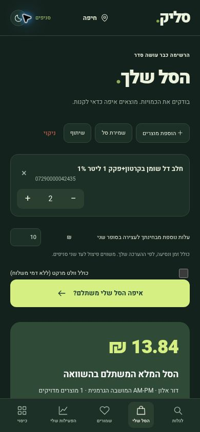

# סליק — דוח אימות ופריסה

נבדק ב־3 בנובמבר 2026, שעון ישראל, על המאגר והדומיין הקיימים.

- אתר פעיל: https://superbasket-mvp.vercel.app/
- קוד: https://github.com/alongerber/superbasket-mvp
- גרסת היישום שנבדקה: `f995c3ccb8c5c0754bd6b5fa2398e25971afd418`.
- CI: https://github.com/alongerber/superbasket-mvp/actions/runs/41545565402

## בדיקות שבוצעו

| בדיקה | תוצאה וגבולות |
|---|---|
| בדיקות Node | 15 עברו מקומית, כולל חיפוש/API מול נתוני מקור אמיתיים |
| בדיקות Python | 3 עברו: עדכון מחיר, הסרת מחיר שהתאפס, הפרדת קודים פנימיים בין רשתות |
| תקינות נתונים | SHA-256 לכל אובייקט, זהות סניף, ספירות, מפתחות ייחודיים ו־SQLite integrity_check |
| נפח שנבדק מקומית | 639 מחירוני סניפים, 5,094,727 רשומות ו־135,978 מוצרים; זה אינו מספר הסניפים שפורסמו באתר |
| עומס מקומי | 200 מוצרים מול 60 סניפים: 2.917 שניות; תגובת API בגודל 3.34MB לפני דחיסת HTTP |
| API באתר הפעיל | חיפוש עברי, ברקוד מדויק, כמות 3 מול מחירים ב־12 סניפים, חוסר ללא מחיר מומצא, קלט לא תקין |
| ממשק נייד | אתר production במסגרת 390px; חיפוש, הוספה, שינוי כמות, השוואה, ניווט תחתון ומצב כהה; אין גלישה אופקית |
| תמונות | תמונות Open Food Facts נטענו באתר הפעיל בהתאמת ברקוד; ללא התאמה מוצג סמל כללי מסומן |
| רשימה ארוכה | מסלול התאמה ידנית של מספר שורות נבדק; מעבר אוטומטי לשורה הבאה לאחר בחירה |
| צילום רשימה | שלוש שורות בעברית זוהו מתמונת בדיקה באמצעות Tesseract; הטקסט מוצג לאישור לפני התאמת מוצרים |
| סלים | שמירה מקומית נבדקה; קישור שיתוף נוצר, נפתח ויובא בכמות הנכונה אחרי אישור |
| מחיר והיסטוריה | מחיר מקור ותאריך אמיתי מוצגים; מדידה בודדת מסומנת כך, ללא גרף היסטורי מומצא |
| התראות | יעד מחיר נשמר באתר הפעיל; לאחר רענון נבדק מחדש מול המקור והוצג שהמחיר הגיע ליעד |
| PWA | manifest, service worker ואייקונים מוגשים בהצלחה ב־HTTPS; התקנה פיזית ותרחיש אופליין במכשיר אמיתי לא נבדקו |
| קול | חיבור Web Speech בעברית קיים; לא בוצעה הקלטת מיקרופון אמיתית |

## הגנות במנוע ההשוואה

ההתאמה היא לפי GTIN מדויק. קודים פנימיים ומשקליים מופרדים לפי רשת. סכומים מחושבים באגורות; כמות חלקית למוצר ארוז אינה מתקבלת כמוצר מותאם. סל חלקי, מחירון מעל 36 שעות ותאריך לא תקין אינם זוכים בדירוג. הפיצול בוחן את כל זוגות הסניפים שנבחרו, מחייב כיסוי מלא ומוסיף את עלות העצירה שהמשתמש הזין. אין חיסכון מוצג ללא סל מלא להשוואה. פרסום מחיר אינו התחייבות למלאי.

## איסוף ותפעול

איסוף רשמי מוגדר ל־32 רשומות רשת ומתוזמן כל שלוש שעות. כל מחירון שנקלט כולל שם קובץ, מועד פרסום וחתימה. הפרסום אטומי דרך manifest המפנה לאובייקטים בלתי משתנים; נקודות שמירה זמניות אינן מפורסמות. המחירון האחרון נשמר בעת כשל מקור, וחותמת הזמן אינה מתעדכנת כאילו נמשכו מחירים חדשים.

הפרסום החוזר מ־02.11.2026 בשעה 23:33 UTC כלל 176 סניפים מ־9 רשתות, 79,814 מוצרים ו־1,430,077 רשומות מחיר. נבדק שאין הפניות לקבצים חסרים ושאין נקודות שמירה זמניות בענף הנתונים.

מספרי הכיסוי הקובעים מופיעים ב־`/api/status` ובמסך הכיסוי. תהליך האיסוף הראשוני ממשיך ברקע ב־GitHub Actions. הגדרת תזמון אינה הוכחה להשלמת איסוף בכל מועד.

## טרם הושלם או חסום

- אין עדיין כיסוי ארצי מלא. קיימים כשלי גישה, קבצים חסרים וסניפים שטרם נקלטו; למשל GitHub runner קיבל 403 מחצי חינם, timeout מקארפור, ולא מצא Stores לסופר־פארם. אלו תצפיות מסביבת האיסוף, לא קביעה שהאתרים סגורים לכל משתמש.
- תשתית SQLite ואובייקטים דחוסים עובדת בנפח שנבדק. GitHub משמש אחסון ביניים; לא הוקם מסד מנוהל בעל קיבולת ו־SLA ארציים. לא נמצאו חיבורי מסד קיימים במשתני הסביבה של פרויקט Vercel. גידול Git והעברת נתונים מחייבים תכנון אחסון קבוע.
- מבצעים נקלטים ומוצגים עם תנאים, אך אינם מנוכים. סמנטיקת המועדונים, קופונים ומבצעי כמות לא אומתה לחישוב אוטומטי מלא.
- תחליפים נבחרים ידנית; אין החלפה סמויה או הבטחת התאמה סמנטית.
- ההתראות מקומיות בעת פתיחה; אין Push ברקע. סלים אינם מסונכרנים בין חשבונות או מכשירים.
- אין טענה לבדיקת מכשיר iOS/Android פיזי, התקנת PWA, או הכתבה קולית בפועל.
- לא נרכש שירות ולא הורחבו הרשאות.

